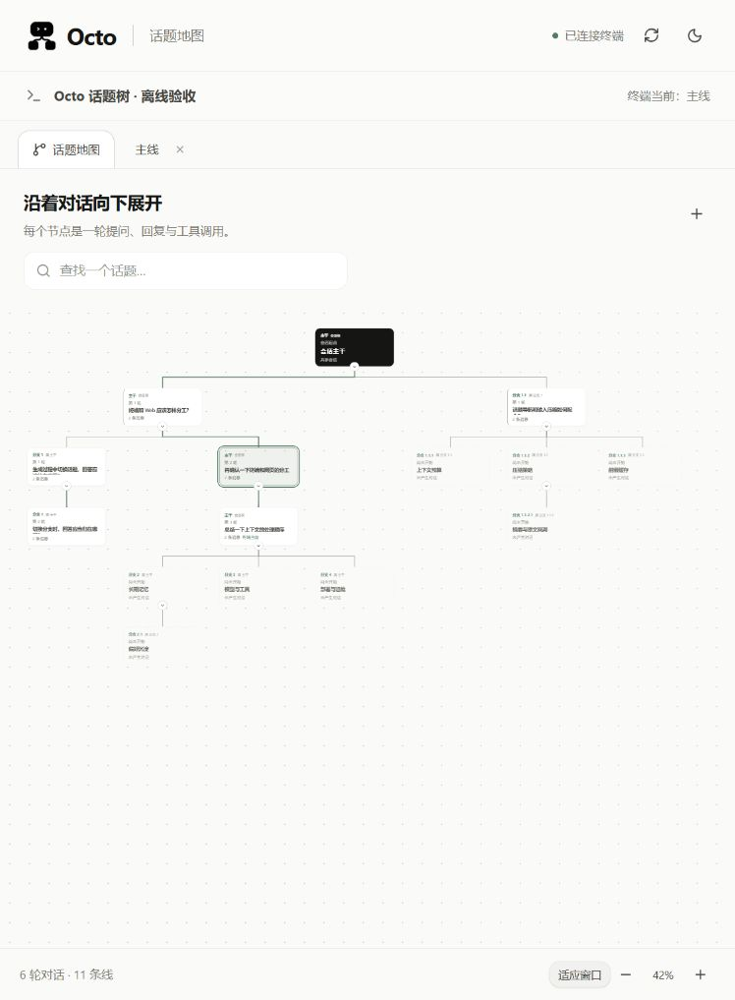
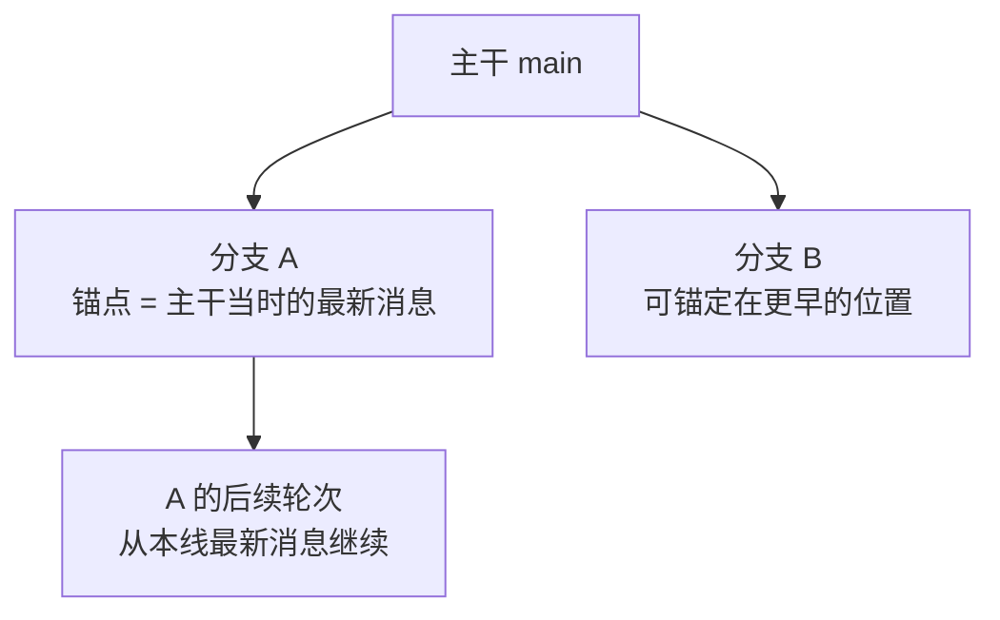
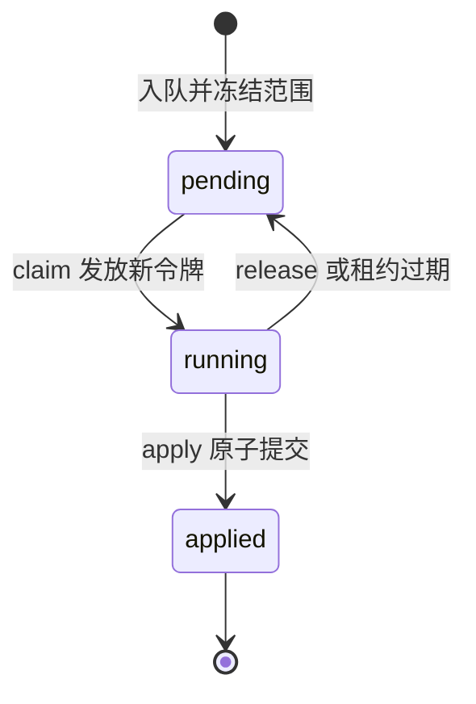

# Octo-agent

一个终端编程 Agent（CLI / TUI）。用话题树管理同一件事的分支讨论，用后台长期记忆跨会话记住稳定偏好。

[](https://www.python.org/)
[](https://github.com/NelxJoe306/Octo-agent/actions/workflows/ci.yml)
[](LICENSE)

**状态：实验性（`v0.1.0`）。** 仍在演进，适合个人使用。

**30 秒速览**

- **做什么**：在终端里跑编程任务，会话持久化在本地 SQLite，并可用 `/map` 打开 Web 话题地图。
- **两个核心机制**：话题树管分支归属和续接；后台长期记忆跨会话召回用户明确表达的偏好。
- **怎么验证**：运行 `tools/verify.py`，离线冒烟 11 项，不配 API Key 也能跑完。



## 它解决什么问题

当我们使用目前的线性对话界面时，我们不能很直观的看到我们之前问了什么，是以什么样的结构问的，导致我们在长对话下很难找到我们问了什么，也很难回过头复盘这些对话。

我的做法是把同一会话组织成话题树：新分支用锚点引用父线当时的位置，本线从自己的续接点继续，消息正文不复制。发给模型的是带归属标注的共享历史。跨会话仍然需要记住的稳定偏好，则由后台任务提炼进长期记忆。

同时作为一项Personal Agent（pa）的项目在不断演进，在实现长期记忆、上下文harness等agent开发相关领域的功能。

目前离线测试 11 项通过，不配 API Key 也能跑完整流程。跨会话偏好召回已用 20 个合成样本、使用 `deepseek-flash` 串行实测三轮，结果写在下方「长期记忆」一节。

## 话题树

话题树要回答的不是「再开一个聊天窗口」，而是：同一件事的分岔讨论，如何共用一份日志、却仍能分清归属，并从正确的位置继续。

**为什么不用现成的会话管理。** 多轮会话文件能隔离，但约定、工具结果和已踩过的坑不会自动带过去，人要自己搬运。单会话全量上下文能保留所有信息，但分支会挤在同一条时间线上，窗口更快被撑满，模型也更难判断当前该顺着哪条线回答。Octo 选择：同一会话共享一份不可变日志，用话题树记录每条消息属于哪条线、这条线从哪里分出去、下次从哪里继续。代价是模型侧看到的并不是「只含本线祖先」的硬隔离上下文，而是带 `history_sources` 归属标注的共享历史；切换话题时，也不会把当前上下文裁回本线的祖先路径。

**父话题上下文怎么继承。** 不是复制，也不是摘要，而是引用。创建分支时写入 `anchor_entry_id`：未指定时，默认是父线当时的最新消息。消息正文仍留在原日志里，不另拷一份，也不改写旧记录。空分支从这条锚点继续；已有消息的分支从本线自己的最新消息继续。主干只查询主干自己的最新消息，不会把某个子分支的最新位置当成主干续接点。请求在入队时冻结话题；实际开始时再解析该分支当时的最新续接点，避免排队期间前一条请求又写出了新消息。

**上下文预算怎么分配。** 这是全会话的 token 门控，不是「同层最多保留 N 轮」。默认软限制是上下文窗口的 80%，硬限制是 `窗口 - 输出预留 - 1024`。估算输入低于软限制时放行，达到软限制会触发压缩（把更早的消息收成摘要，并保住最近一轮请求），超过硬限制则阻断，需要先压缩或调整模型上限后再试。图片另计预留（默认每张 4096）。这套规则按整段会话预算计算，并不按话题层级切分轮数。

**Web 端 snapshot 为什么要做环检测。** 话题在用户误操作或数据迁移后，`parent_id` 可能指向缺失节点，或互相成环。`/map` 的前端用 zod schema 的 `superRefine`，沿 `parent_id` 向上遍历；一旦遇到缺失父节点、重复访问或成环，就拒绝这份 snapshot，避免布局计算死循环。会话条目树在后端沿 `parent_id` 回溯路径时，同样会检测环。



在运行中的 `octo` 里输入 `/map`，会在浏览器打开附着当前会话的话题树。Web 窗口只用于浏览记录、创建和切换分支，不能在网页里直接发消息、改模型或执行工具。首次使用前需要安装并构建前端，见 [安装说明](docs/install.md)。

## 长期记忆

长期记忆要解决的是跨会话失忆：新会话不应丢掉用户已经明确说过要记住、更正或忘掉的偏好。通用事实会保留来源，但不会自动注入到其他会话。

**何时触发。** 三种条件都会尝试提炼，触发词只决定「要不要试」，不代表必须新增一条事实：

- 累计达到阈值：默认 32 条原始 User / Assistant / Tool 消息（不含压缩摘要和自定义日志），可在 `${OCTO_HOME}/settings.json` 里把 `memory.message_threshold` 调到 1–1000。
- 用户消息命中触发词：`记住`、`记一下`、`记下来`、`更正`、`纠正`、`忘掉`、`不要再记`，以及英文 `remember` / `forget` / `correct`。
- 正常退出会话时处理尾部。强制终止时，已入队的任务靠租约恢复；尚未入队的原文会在下次打开该会话时重新检查。

**租约队列如何防重复和并发。** 主会话只负责通知后台，不把提炼放进当前这轮 ReAct 循环。worker 先把「从学习进度到指定原文」的连续范围写入 SQLite，再独立调用模型。同一会话同时只允许一个未完成任务，范围不能重叠；重复提交同一端点会返回原任务。领取任务时在事务里发放新令牌并开始租约；提交时把事实变化、学习进度、任务状态和不可改写的收据放在同一事务里。旧令牌不能提交或释放新任务；相同令牌和相同操作的重放是幂等的，不会再应用一次。租约到期后可被其他进程重新领取。失败至少间隔 30 秒再试，同一 runtime 对单任务最多自动失败 3 次。



**跨会话怎么召回。** 每次请求开始时，从 SQLite 查询仍然有效的 preference，按整条事实装入预算：上限约 1024 估算 token，并随模型窗口缩小（实现里还会再和 `窗口 / 12` 取较小值）。超大的单条偏好不会截成半条，而是本次跳过。通用 fact 不跨会话自动注入。召回作为带来源的数据附在模型输入里，不改写聊天原文或系统提示。本轮工具循环使用固定快照，后台新完成的偏好从下一次请求才可见。这里没有向量检索，匹配方式就是「有效偏好 + token 预算」。

**为什么要有 `memory.md`。** `${OCTO_HOME}/memory.md` 是 SQLite 的单向幂等镜像：可读、可 diff，也便于在不启动 Agent、不调用模型的情况下重建这份 Markdown。它不参加事实事务，也不会被当作提炼或召回的输入。手工修改会在下次导出时被覆盖。镜像允许滞后或丢失，**数据库并不依赖它来恢复**；库损坏或升级前，应直接备份 `octo.db`。镜像损坏或滞后时，可执行：

```powershell
.\.venv\Scripts\python.exe tools/export_memory.py
```

默认使用 `${OCTO_HOME}`。若指定其他目录，请传绝对路径，例如 `--home $env:USERPROFILE\.octo`，不要传未展开的 `~/.octo`。

后台记忆默认开启，会增加模型调用：大约每满 32 条原始消息（再加上触发词或正常退出）多一次提炼请求。如需关闭，设置 `OCTO_DISABLE_MEMORY=1`，或在 `${OCTO_HOME}/settings.json` 里将 `memory.enabled` 设为 `false`。

**跨会话召回测了什么。** 评测日期 2026-11-15，基线 `bf50f9d`，提炼模型为 `deepseek-flash`。20 个合成样本里，9 条要求新增偏好，1 条要求用新偏好覆盖旧值，10 条要求忽略（一次性要求、引用文本、工具输出、假设性更正等）。项目事实的隔离由仓库既有测试覆盖，不计入这 20 条。每例使用临时空库，按固定原文写入后，用 `notify(force=True)` 强制触发生产实现的后台提炼；这与默认 32 条消息阈值不同，否则这些短样本凑不够轮数，一次也提炼不出来。再在新会话里检查发给主模型的请求中，是否出现完整的有效偏好记录。判定看的是注入结果，不是向量检索，也不检查模型最终是否遵从偏好。三轮按固定顺序串行执行，没有按结果调整提示词或重跑择优。完整口径、逐条证据和复现命令见 [评测交接](eval/memory/评测交接.md)。

| 指标 | 第一轮 | 第二轮 | 第三轮 |
| --- | ---: | ---: | ---: |
| 自动判定的跨会话召回 | 10/10 | 9/10 | 10/10 |
| 复核注入文本后的跨会话召回 | 10/10 | 10/10 | 10/10 |
| 应忽略样本中发生误记 | 1/10 | 2/10 | 2/10 |
| 应忽略样本中错误偏好进入新会话 | 1/10 | 1/10 | 1/10 |
| 覆盖成功 | 1/1 | 1/1 | 1/1 |

语义复核后的召回三轮均为 10/10。自动规则使用中英文正则，第二轮有一条已正确写入并注入的英文同义表达（`start with examples`）未被规则覆盖，因而记成 9/10；语义复核由执行评测的助手完成，未做独立双人标注，自动分保留供复查。应忽略样本的误记合计 5/30（16.7%），其中 3/30 作为错误偏好进入了新会话；另外两次误写成普通 fact，只检查新会话注入会漏掉。覆盖 3/3。60 次用例执行没有后台错误或探针失败。同一输入三轮的通过/失败判定为 19/20 一致。66 次提炼共 27,008 token，平均约 409 token/次。

**目前看得出的边界。** 「下午借 Windows 电脑，这次要 PowerShell」三轮都落了库：第一轮虽然正文还写着一次性请求，却被标成 preference，因而注入下一会话；后两轮标成 fact。另外，「这次用 uv 复现同事的问题」在后两轮被存成偏好并注入，第一轮正确忽略——只看关键词无法区分工具选择的有效期。这次评测量的是持久化和跨会话注入，没有量到海量记忆竞争预算时的排序、模型最终是否遵从偏好，或真实对话中的误记发生率。

## 架构与模块边界

| 目录 | 职责 | 可依赖 |
| --- | --- | --- |
| `src/agent_core/` | 消息与工具协议、ReAct 主循环、上下文预算门控、SQLite / JSONL 会话与话题树存储 | 标准库和基础库 |
| `src/model_adapters/` | OpenAI 兼容与 Anthropic 适配器、流式事件与请求预算 | `agent_core` |
| `src/long_term_memory/` | 事实库、租约任务队列、后台提炼、`memory.md` 单向镜像 | `agent_core`，以及 `model_adapters` 的协议 |
| `src/terminal_app/` | CLI / TUI、文件与 Shell 工具、Provider 生命周期、本机话题地图接口 | 上述三个模块 |
| `web/` | 独立构建的 Next.js 话题地图 | 本机 HTTP 接口，不导入 Python 源码 |

模块边界由 `tests/core/test_module_boundaries.py` 自动校验：扫描 `src/` 下的 import，基础模块若反向导入 `terminal_app` 或违反依赖方向，测试会失败。更完整的约定见 [docs/module-layout.md](docs/module-layout.md)。

## 可验证性

不配真实 API Key，也可以验证主路径。`tools/verify.py` 会跑 11 项离线冒烟，成功时打印 JSON，例如 `"tests": 11, "failures": 0, "errors": 0, "success": true`。这 11 项分别覆盖：

1. 全部模块能够编译并导入
2. 已删除的旧名称与旧功能不再出现
3. 源码注释约定
4. CLI 的 help 与版本号
5. 打包资源与 `OCTO_HOME`
6. 项目指令（如 `AGENTS.md`）能进入系统提示
7. 文件与 Shell 工具（`read` / `write` / `edit` / `bash`）
8. Agent 工具循环，以及持久化后恢复再继续
9. 扩展对工具调用的权限拦截
10. TUI 能够挂载并渲染当前品牌
11. HTML 导出会话仍能渲染

记忆相关的更细验证在 `tests/memory/`：存储事务、租约竞争、幂等重放，以及 `memory.md` 的幂等导出、手改不回流、脱模型重建。这些测试使用临时数据库和假模型，不访问真实 API。样本评测的离线判定回归在 `tests/memory/test_memory_eval.py`，覆盖误写普通事实、后台失败、旧值替代及并存旧值；用真实模型重跑 20 样本三轮需要本机配置，并会产生 API 用量，命令见 [评测交接](eval/memory/评测交接.md)。

Python 测试没有额外的测试专用依赖，只用标准库 `unittest`，再加上已写在 `pyproject.toml` 项目依赖里的包（例如 `httpx`、`typer`）。Web 测试依赖 `web/` 里的 `tsx` 和 `typescript`。上面这些离线命令也会在 GitHub Actions 中于每次推送和 PR 上运行；真实模型评测不进入 CI。

全量检查：

```powershell
.\.venv\Scripts\python.exe tools/verify.py
.\.venv\Scripts\python.exe -m unittest discover -s tests -t . -p "test_*.py" -q
# 若改动涉及 web/：
npm --prefix web test
npm --prefix web run typecheck
npm --prefix web run build
```

## 快速开始

**前置要求**：Python 3.12+、`uv`。若要使用 `/map`，还需要 Node.js 与 `npm`。依赖会隔离安装到 `dependencies/`，避免污染系统 Python，并校验路径不会越出仓库根目录。细节见 [docs/install.md](docs/install.md)。

```powershell
git clone https://github.com/NelxJoe306/Octo-agent.git
cd Octo-agent

python tools/install_dependencies.py --python-only

.\.venv\Scripts\python.exe tools/verify.py

$env:OPENAI_API_KEY = "sk-xxx"
.\.venv\Scripts\octo.exe setup

.\.venv\Scripts\octo.exe
```

第 4 步默认模型是 `gpt-5.4`。若使用第三方 OpenAI 兼容接口，请加上 `--base-url` 和 `--model`。Linux / macOS 将 `.\.venv\Scripts\octo.exe` 换成 `./.venv/bin/octo`。常用命令、环境变量和 Web 构建步骤也写在 [docs/install.md](docs/install.md)。

`octo.py` 是为了在未做可编辑安装时直接跑，它会把 `src/` 临时加入模块搜索路径；正式入口仍是安装后的 `octo` 命令。两者都调用 `terminal_app.cli`。

## 已知限制

- **SQLite 库不向下兼容。** 当前会话数据库为 `schema 6`，旧版程序无法直接打开升级后的数据库。这样设计是为了让记忆进度、任务和收据与会话日志一起做原子提交。升级前请先关闭旧进程，并备份 `${OCTO_HOME}/octo.db`（或使用 SQLite backup）。`export_memory.py` 只能重建 `memory.md`，不能用来恢复或重建数据库。
- **JSONL 导出不等于完整备份。** `octo export` 的 JSONL 不含超长工具输出产物（`tool_artifacts` BLOB）和长期记忆表，旧格式也不携带话题表。完整备份请直接复制 `octo.db`。
- **`memory.md` 只是只读镜像。** 手动修改不会写回数据库，下次导出时会被覆盖。它的用途是阅读和对比，不是灾备；库出问题时应使用 `octo.db` 备份。
- **后台记忆会增加模型调用。** 默认大约每满 32 条原始消息（再加上触发词或正常退出）会多一次独立的提炼请求。这是为了不把提炼塞进当前对话的主循环。如需零额外调用，设置 `OCTO_DISABLE_MEMORY=1`，或将 `memory.enabled` 设为 `false`。
- **Web 窗口只读交互。** `/map` 只用于浏览、创建和切换话题，不支持在网页端发送聊天、配置模型或执行工具。终端仍然是唯一的执行入口，浏览器也不接收模型凭据。

许可证：MIT（见 [LICENSE](LICENSE)）。
