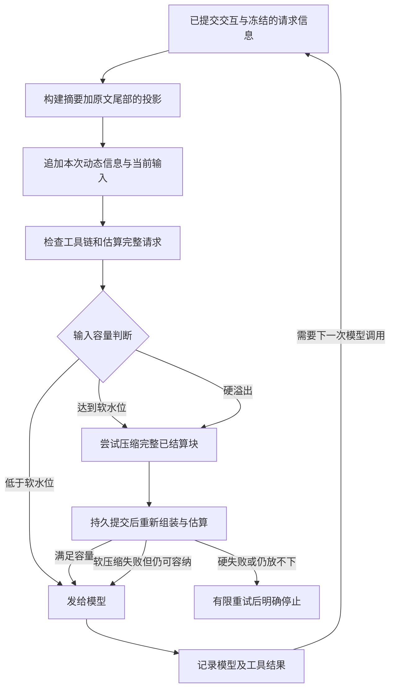

# Octo v1 设计与实现记录

更新日期：2026-11-14。

本文记录各部分的设计、实现位置、当前进度及验证结果。已交付上下文调用前接口、SQLite 会话存储和终端话题地图首版；每次按用户给出的步骤修改并展示结果，用户明确认可后才 commit。

## 1. 如何阅读与维护

- **现有实现**：本次已从源码确认的行为。
- **目标设计**：来自交接文档或会话决定、尚待落地的行为。
- **建议，待确认**：审阅中提出的具体接口、规则修订或实现选择。
- **验证记录**：只登记实际执行过的检查，注明适用范围；设计中的验收条件不等于测试已经通过。

设计发生变化时直接更新对应章节，并在末尾实现记录注明原因。实际实现与本文不一致时，先确认差异的原因，再同步设计和代码。

来源：用户提供的《Octo-v1-实现交接文档》、本会话后续修订，以及本机源码核查。交接文档中的旧规则由下文已确认的修订替代。

## 2. 总体目标与当前状态

Octo 是个人编程与系统运维助手。一个主 Agent 处理共享会话，话题帮助用户组织讨论，上下文 harness 控制每次模型输入，长期记忆保存可回溯的偏好与事实。

| 部分 | 当前实现 | v1 目标 |
| --- | --- | --- |
| 模型与工具主循环 | 已有流式调用、工具执行、事件通知；已增加可选调用前准备接口 | 后续接入完整上下文策略 |
| 会话存储 | 已接入 SQLite 会话日志与目录；保留 JSONL 导入/导出 | 随话题、请求与压缩功能增加对应事务记录 |
| 话题与请求归因 | 已实现 SQLite 话题、请求归属、终端命令与 Web 地图 | 后续增加话题摘要与检索 |
| 上下文 harness | 已完成准备接口、消息副本隔离、工具链校验与完整预算软硬门控 | 后续接入压缩；输入快照只预留单次调试模式 |
| 长内容与会话压缩 | bash 已有输出截断；会话已有摘要压缩 | 持久 artifact、完整批次切点、非破坏投影 |
| 长期记忆 | 尚无 v1 结构化事实库与提炼队列 | 阈值驱动异步提炼、证据引用、幂等恢复 |
| Skill | 已有发现、索引注入和显式展开 | 按需正文、pin、真实加载记录 |
| 桌面与可视化 | 终端主入口 + Next.js 静态话题地图，同进程本机接口 | 保持辅助窗口范围，继续完善话题导航 |

表中分别标记现有实现与 v1 目标；目标不能作为已完成能力对外描述。

## 3. 会话、话题和请求

### 设计

- **共享会话历史**：同一会话所有话题已经发生的交互。话题切换不会丢弃其他话题历史。
- **话题**：用户手动建立的讨论归属，可有父子关系；它不是独立 Agent 或独立执行上下文。
- **请求**：一次用户发送及后续模型、工具交互。`request_id → topic_id` 在发送时冻结。
- **分叉锚点**：从哪条旧消息继续讨论；不是退回那一时刻的知识状态。
- **话题摘要**：用于导航和检索；与缩短模型输入的会话压缩摘要分别维护。

全局时间顺序、话题父子关系和请求归因分别存储。用户在 A 话题发送后切到 B，A 的流式内容、工具结果及最终回复仍属于 A。前台请求由一个主 Agent 线性处理。

### 实现与验收

实现位置：`octo_agent/session/topics.py`、`octo_coding/session.py`、`octo_coding/topic_web.py`。模型输入中的话题信息取当前请求冻结的归属，不读取生成过程中变化的 UI 焦点。

验收：发送到 A 后切到 B，结果归属保持 A；从旧消息建立子话题不改变旧消息归属；纯导航不触发模型请求。

## 4. 存储与权威来源

### 已确认设计

新会话以 **SQLite 为唯一权威**，JSONL 用于旧历史导入和导出。新架构不依赖两种格式同时写成功来维持正确性。

目标使用 `$OCTO_HOME/octo.db`，SQLite WAL。建议由一个 Python 后端拥有写入，TUI 与桌面共用后端逻辑；进程独占和连接方式在接入桌面时明确。

主要记录：会话、话题、请求、只增消息、artifact、压缩摘要与 head、记忆条目与任务/收据、Skill 加载、更正记录。

- 已提交消息正文保持不变。压缩只增加摘要、改变投影所用的 head。
- 会话内 `seq` 表示时间顺序；消息 ID 表示稳定引用，不能用列表下标或 Python 对象地址作为持久证据 ID。
- 请求、输入消息及归属应一致提交；摘要记录和 head 推进在同一事务提交。
- 旧 JSONL 导入须保留可追踪映射，重复导入去重。历史分支导入规则单独明确，不自动把旧 `parent_id` 当成新话题关系。

### 当前实现：SQLite 会话存储已接入

`octo_agent/session/sqlite.py` 提供 `SQLiteSessionDatabase` 与 `SQLiteSessionStorage`，使用 Python 标准库 sqlite3。数据库路径由 `OctoPaths.database_path` 统一给出，使用 WAL、外键和 schema 版本检查。连接按操作创建与关闭；批量写入使用 `BEGIN IMMEDIATE`，异常整批回滚。

当前 schema：

| 表 | 保存内容 | 一致性规则 |
| --- | --- | --- |
| `sessions` | 会话 ID 与目录元数据快照 | 受管会话首次落盘时与日志同事务写入；已有快照保留，避免旧副本覆盖重命名 |
| `session_entries` | 会话 ID、原条目 ID、会话内 seq、不可变正文 | `(session_id, id)` 与 `(session_id, seq)` 唯一；相同 ID/内容重试幂等，内容冲突报错；触发器拒绝更新与删除 |
| `legacy_imports` | 原 JSONL 绝对路径、文件哈希、目标会话和导入时间 | 与整批导入及首次目录快照同事务提交；保留来源映射 |

本阶段复用现有 `SessionEntry` 协议，所有旧条目类型都能保留；`seq` 排列完整日志条目，而不只排列用户消息。原文回读使用会话 ID 与条目 ID 定位，导入保留旧 ID；后续跨会话证据引用需要带会话范围。

`SessionManager.storage_for(record)` 是受管会话的存储入口。CLI print、RPC、TUI 启动，以及运行中的新建/恢复均使用此入口。新会话的目录和消息都写 SQLite，不再生成 JSONL 会话文件或 JSONL 索引。显式传入的内存/JSONL 存储仍可用于测试和旧格式操作。

旧会话的索引继续只读发现，SQLite 中同 ID 的目录记录优先。打开尚未迁移的旧会话时，先完整解析 JSONL，再原子导入日志、目录和来源映射；源文件保持原样。再次导入相同条目去重，内容漂移拒绝，损坏输入不会提交合法前缀。SQLite 已有目录时，后续恢复不再依赖源 JSONL 是否存在。旧索引读取或逐行解析错误带文件位置告警并隔离，不影响健康 SQLite 会话。

`SessionStorage` 的 append / append_batch / read_all 契约保持可用，新增 SQLite `read_entry(id)` 回读及 `import_jsonl(path)` 导入。同步初始化也通过 SQLite 批量事务；异步读写在线程中执行。取消异步等待不代表工作线程中的事务已回滚，恢复时依赖稳定 ID 检查和重试去重。

导出按会话 ID 从 SQLite 读取，可输出 JSONL 或 HTML。CLI、运行中导出与 HTML 内嵌下载共用会话文件名规则；实际数据库路径独立用于保护检查，导出不能覆盖源数据库、WAL/SHM 或原始日志。

RPC `sessionFile` 对 SQLite 返回 `数据库绝对路径#session=会话ID`，可原样交回 `switch_session.sessionPath`；也继续支持直接传 `sessionId`。同一裸数据库路径匹配多个会话时明确拒绝，不能任选其中一个。JSONL 旧路径仍按唯一匹配解析。

### 范围与验收

已完成会话日志、目录、旧历史导入/导出和既有入口接入。新话题/请求表、artifact、压缩摘要与 head、后台记忆任务等尚未建立，随对应功能接入同一数据库；不能把这些后续事务称为本阶段已经实现。

`octo_agent/session/memory.py` 仍按旧协议恢复 active leaf 与压缩条目；导入旧分支不会自动生成 v1 话题。未来共享话题历史的投影在 context harness / 话题模块实现，当前存储保留完整原记录供其使用。

`tools/test_sqlite_storage.py` 共 12 项：重启恢复与会话隔离、稳定 ID 回读、幂等重试/冲突回滚、受管会话目录恢复、新会话不写 JSONL、重复导入及源文件保留、真实对话持久化/新建/重命名/导出、12 个并发批次、损坏输入无部分导入、导出源保护、首次消息与目录原子性、旧索引错误隔离、真实 RPC 会话定位及 HTML 下载命名。其中相关行为合并在同一项端到端测试验证。

验证：12 项存储测试 + 5 项 harness 测试 + 11 项原有离线检查全部通过，`git diff --check` 通过。所有数据夹具使用临时目录；本轮没有运行真实用户历史批量迁移。

## 5. 上下文 harness（当前优先部分）

### 5.1 职责与接入位置

目标：在**每一次主 Agent 模型调用前**，从已发生交互组装本次输入，估算完整请求，必要时压缩，并给出可追踪的调用视图。它不负责执行工具，也不承担后台记忆模型调用。

当前调用链：

```text
CodingSession
  → AgentHarness
  → run_agent_loop
  → _provider_context
  → _assistant_events
  → ModelProvider.stream_response
```

源码依据：`octo_agent/loop.py`、`octo_agent/harness.py`、`octo_agent/provider.py`。

**已实现首个切片**：在 `run_agent_loop` 调用 `_assistant_events` 之前增加可等待的 `prepare_context` 接口，由 `AgentHarnessConfig` 注入，首轮及每个工具批次后的下一轮均经过它。准备逻辑集中在 `octo_agent/context_harness.py`。当前 SQLite `CodingSession` 已装配话题动态信息投影；2026-11-14 已追加完整预算软硬门控，压缩消费信号和记忆策略尚未装配。

现有 `replace_messages()` 会重新绑定列表，运行中循环仍持有原列表，因此不能仅在 `turn_end` 监听器里调用它来替换下一轮输入。事件通知适合记录与入队，不能作为隐含的上下文替换机制。

选择循环调用前接口的理由：它明确覆盖每个主调用，也能与摘要模型调用区分，避免在 provider 外层包装后，摘要调用递归进入压缩。

### 5.2 输入与输出接口草案

以下是表达设计的类型草图，尚未创建这些类或冻结字段：

```python
class RequestContext:
    session_id: str
    request_id: str
    topic_id: str

class HistorySnapshot:
    # 持久记录的稳定 ID、消息内容、读取位置与压缩 head
    ...

class PreparedContext:
    messages: tuple[AgentMessage, ...]
    estimated_input_tokens: int
    summary_ref: str | None
    notices: tuple[str, ...]

class ContextHarness:
    async def prepare(
        self, request: RequestContext, history: HistorySnapshot
    ) -> PreparedContext:
        ...
```

构造时注入稳定 system/tools、统一的有效模型限额、估算器、存储与压缩依赖。调用者只获取本次输入及诊断信息；预算、切点、摘要选择集中在模块内部。

首个切片实际接口为 `prepare_context(messages, *, signal)`，由 `PrepareContext` Protocol 声明参数：接收消息深副本组成的 tuple，异步返回消息序列。原始消息不被重绑定或改写；返回结果再次复制后校验工具链，然后只用于本次 provider 调用。system 与 tools 不在返回值中，不能通过该接口切换工具 schema。返回视图缺失调用/结果、顺序错误或调用与结果的工具名称不一致时抛出 `ValueError`，不会静默使用修复后的内容。

准备前后检查取消状态，取消以 `CancelledError` 上浮；正在等待中的准备函数需协作观察 signal，或由外层取消任务。当前不提供超时或强制中止忽略 signal 的任意回调。准备异常原样上浮，harness 清理运行状态。未配置准备函数时，保留原有历史修复和调用路径。

消息快照和投影分离：循环持续追加原始交互，`PreparedContext.messages` 仅供本次模型调用使用。投影使用独立的数据副本，不通过修改消息对象内容影响原始记录。SQLite 接入后，由会话层保证新消息已提交，再读取带版本位置的快照；测试可使用内存记录，不另建一套生产权威存储。

### 5.3 每次调用的处理流程



工具链检查必须针对最终发送视图；不能先预算，再无记录地增加修复消息。恢复时已有的工具历史修复与正常执行时的已结算判断分开：未完成调用不能靠补一个假结果变成可压缩块。

### 5.4 请求排列与前缀缓存

交接文档要求 system/tool schema 稳定。**建议修订，待确认**：本次动态块追加在已有历史之后，排列如下：

```text
稳定 system 与工具 schema
历史投影：压缩摘要（若有）+ 已提交的原文尾部
本次动态块：冻结的话题信息、画像快照、检索结果、需要注入的 Skill
当前用户输入及绑定在这次输入上的 reminder
```

本次动态块随调用记录保存，后续重放保持原位置与内容；异步更新的画像留到下一请求。新输入及动态块的具体 role/消息组合在实现时确定，记录必须能复现实际发出的顺序。

理由：动态信息若放在历史前面，每次变化都会让共同前缀在历史开始前分叉。只保证 system hash 相同，不能证明长段历史也能继续复用。

用户主动变更模型、扩展、工具配置时形成新的明确配置版本，不承诺跨配置仍字节一致。压缩同样会改变历史投影，应记录缓存边界。

缓存验证区分：固定前置是否一致、共同前缀能保持多长，以及 provider 实际报告的缓存使用量。前两项不能替代真实缓存命中测量。

### 5.5 预算与软硬门控（2026-11-14 已实现）

本切片负责计算、判断、拦截和诊断。`octo_agent/context_budget.py` 集中维护纯计算策略、完整输入估算和决策；`AgentHarnessConfig.check_context` 由 `CodingSession` 装配，在准备完成且工具链校验通过后、每个主推理请求之前执行。首轮、工具批次后的下一轮、steering、follow-up 与 continue 均走同一入口。

```text
原始历史 → prepare_context → 工具链校验 → check_context → provider
W = 有效上下文窗口
O = 实际请求输出上限，或不支持该参数的适配器所声明的模型输出最大值
M = 估算安全余量（默认 1024）
hard_input_limit = W - O - M
soft_limit = min(floor(W * 0.80), hard_input_limit)
```

优先使用当前 provider/model 的 runtime `effective_context_window`，没有 runtime 数据时沿用原有模型配置窗口和 128000 回退窗口。`CodingSessionConfig` 可设置 `context_safety_margin`、`context_soft_ratio`、`context_image_reserve`；尚未增加 CLI 参数或配置文件字段。正常发送需要硬输入容量大于零；输出预留与安全余量耗尽输入容量时仍生成 `BLOCK` 决策并抛出 `ContextBudgetExceeded`，不再因构造策略而丢失诊断。

三个决策：输入低于软水位为 `ALLOW`；达到软水位且不超过硬上限为 `NEEDS_COMPACTION`，本轮继续；超过硬上限为 `BLOCK`，抛出 `ContextBudgetExceeded`，不会调用本次 provider。恰好等于硬上限允许发送。软信号本阶段不触发第二套摘要，原有会话级自动/手动压缩继续保留，其与新 Harness 的统一接入放在下一切片。

输出限额通过 `octo_ai/model_limits.py` 的 `RequestBudgetProvider.request_token_budget()` 读取，与适配器构造实际请求使用同一个值。`ConfigurableRequestBudgetProvider.configure_request_budget()` 在主调用前将有效窗口、余量和显式覆盖应用到真实请求配置。标准静态/动态工厂分别传递模型窗口与模型输出最大值，不把能力上限当成本次输出目标。

OpenAI Chat、Responses、Google、Mistral 未显式指定输出上限时，取 `min(16384, 模型输出最大值（已知时）, max(1, W // 4), max(1, W - M - 1))`；W 同时受会话有效窗口与适配器已知窗口约束。例：8192 窗口、8192 输出能力、安全余量 1024，默认请求输出为 2048，硬输入上限为 5120。该比例是保留输入空间的默认策略，可以显式覆盖，不是模型能力声明。`context_output_reserve_tokens` 对这些原生适配器会同时覆盖真实请求参数和预留；超出模型能力的覆盖明确报错，覆盖耗尽输入容量则生成 `BLOCK`。缺少窗口信息的直接适配器调用仍回退 16384，实际 `CodingSession` 调用前会按解析到的窗口重新计算。

Anthropic 保留 4096 默认候选，未配置时也受窗口限制；思考预算存在时输出至少为 `thinking_budget + 1024`，OAuth 附加系统文本纳入估算。显式覆盖不足以容纳思考预算时明确报错，不降低账面预留后继续发送更大的真实输出上限。

Codex 原有传输不发送输出上限，本阶段不添加不受支持的字段；预留 runtime 或配置中的模型 `max_output_tokens/max_tokens`，来源标为 `model_maximum`。无法解析时明确报配置错误。自定义适配器可实现 `RequestBudgetProvider`；需要修改真实输出参数时另外实现 `ConfigurableRequestBudgetProvider`。只读预算接口不能完成不一致的覆盖时明确报错，禁止只降低账面预留。未提供预算接口且输出最大值未知时，可显式设置 `CodingSessionConfig.context_output_reserve_tokens`，标为 `configured_reserve`，只代表调用者承诺的预留，不能宣称已限制远端实际输出。

估算每次从最终准备视图重新计算，包含 system、工具名称/说明/JSON schema、历史文本、思考/签名、工具调用参数与结果、摘要/话题提醒和当前输入，不复用可能对应旧投影的 provider usage。ASCII 文本按约 4 字符/token，非 ASCII 按 UTF-8 字节保守估算，附消息和工具封装余量；图片默认每张预留 4096，可配置。这些都是估算，不是 provider tokenizer；未知窗口的回退和图片预算也不能保证远端绝不超窗。远端超窗恢复属于后续切片。

### 5.6 诊断、恢复与验收

每次主调用产生 `ContextBudgetEvent`，只携带数字、决策、预留来源与阈值，不保存完整输入。`CodingSession.last_context_budget` 留存最近一次决策；终端 `/session` 展示最近主请求的估算、剩余输入、软硬上限、输出预留、安全余量和组成。软水位产生终端提醒，硬拦截的异常包含原因。主推理之外的自动命名和旧摘要请求不经过这一 Gate。无法解析限额、无效覆盖等配置错误保存在 `last_context_budget_error`，终端 `/session` 展示具体原因；配置错误发生时可能已按原有流程保存本轮用户输入，但不会静默丢失失败诊断。

门控不裁剪历史、不写摘要、不增添虚构 assistant 错误消息；拦截时本轮用户输入与已执行完的工具结果仍按原有流程保存在 SQLite，历史正文、话题归属与原有记录不被重写。调整限额后可以通过 continue 恢复，换会话时回调重新绑定到当前 `CodingSession`。单次输入快照调试开关仅为后续预留，本阶段没有实现。

验收使用 `tools/test_context_budget.py` 的假 provider、真实 SQLite 临时库和 `httpx.MockTransport`：验证软水位允许发送、硬上限等值允许/超出拦截、准备后提醒计入预算、完整输入组成、工具大结果后拦截、steering/follow-up、取消、恢复、有效窗口、输出参数与预留一致、状态查看、会话替换和持久化归属。新增 `tools/test_small_window_budget.py` 覆盖固定小窗口配置的真实标准工厂、显式覆盖和错误诊断，以及 Chat/Responses/Google/Mistral 的 56 组窗口/覆盖组合、窗口缩小、动态工厂和 Anthropic 思考预算。所有请求均由 MockTransport 接收。本阶段没有调用真实模型 API，也没有新增依赖。

## 6. 长内容外置与会话压缩

### 设计

第一层把长工具结果保存为持久 artifact，模型收到预览、ID 和回读方法。第二层对已结算的历史块生成摘要，保留近期原文与当前工作输入。artifact 保存成功后才能发布引用；失败时保持内容可得或明确失败。

回读工具需要分段读取或搜索定位，并返回游标/截断标记。整段回读又被外置会产生循环引用，验收必须覆盖从大日志中部找到指定内容。

摘要复用已有六段格式；保留话题归属、关键来源引用和未解决事项。只在工具调用与结果完整结算或已明确放弃的位置切分，约 20000 token 近期原文是目标而非固定保证。

摘要记录区分累计覆盖、实际送入摘要模型的原文、未读取的省略消息。摘要可使用上一代摘要更新，但长期记忆不从摘要正文再次提炼。摘要和 head 事务提交，并检查 parent 仍是当前 head；同一引用重放内容一致则幂等，内容漂移则拒绝。

### 实现与验收

已有六段提示和会话级自动压缩位于 `octo_coding/context_window.py` 与 `octo_coding/session.py`。新 artifact、摘要来源分区和 SQLite 原子 head 尚未实现；当前 bash 截断不等于持久 artifact 系统。

验收：回读能取得目标原文；未结算工具不能被压缩；摘要提交失败不推进 head；压缩后重新估算；反复压缩也不删除原始消息。

## 7. 长期记忆

### 已确认设计

分层保存常驻偏好、话题摘要、原始会话记录和语义事实。事实支持 `add / supersede / retract`，保留来源 ID、原文日期和状态。

触发规则已由用户确认修订：未学习交互累计达到阈值后异步入队；明确要求记住或更正时入队；正常结束会话时处理未学习尾部。使用摘要或成功压缩可作为额外触发。具体阈值尚未确定。

编排器只负责持久入队，提炼模型在主生成循环外运行；读取明确允许的原文，不读摘要正文，也不以省略消息冒充已读取证据。用户偏好和更正引用真实用户输入。

任务在模型调用前落盘；模型生成操作草稿后校验来源和字段。事实变更、学习游标和 applied 收据同事务提交。重复处理同一来源范围去重，无变化的成功提炼也推进游标。异常退出留下待恢复任务；正常关闭与强制终止的恢复语义分别测试。

### 待确认与实现

事实适用范围尚待用户确认。建议给事实注明项目、对象及必要环境/版本，例如测试环境 3.12 与生产环境 3.11 可以并存；不能把此建议写成已通过的字段设计。

目标位置：`octo_agent/memory/`，尚未建立。当前 SQLite schema、后台任务机制、模型选型、阈值均待实现或确定。

验收：短会话偏好能在下一会话召回；助手转述不能写成用户事实；来源校验、重复任务、崩溃恢复和日期保留正确。事实适用范围的验收随决定补充。

## 8. 子 Agent 委派（已取消）

2026-11-14 用户确认不实现。移出后续范围，不再规划委派工具、子 Agent 上下文或相关验收。系统继续由单个主 Agent 处理请求。

## 9. Plan／执行模式（已取消）

2026-11-14 用户确认不实现。移出后续范围，不再规划 EnterPlanMode／ExitPlanMode、模式状态提醒或本方案的模式工具隔离。

## 10. Skill 发现、加载与界面记录

现有实现：`octo_coding/skills.py` 发现并读取 `SKILL.md`；`system_prompt.py` 默认注入名称、描述和位置索引，提示模型读取全文；显式 `/skill:name` 可展开正文。不能把现状写成默认注入全部 Skill 正文。

目标设计：正文按需加载，用户可启用和 pin，记录每请求实际加载、来源、原因和估算成本。回读原文等是可调用工具能力，可在 Skill 库展示相应使用说明；Skill 文本本身不能替代工具实现。

目标位置：`octo_coding/skills_runtime.py`，尚未建立。`load_skill` 与模型直接读 Skill 文件的实际注入应能被统一追踪；跨请求 pin 需避免重复正文无限累积。

验收：库中存在不等于本轮加载；加载 trace 与实际输入一致；正文和索引成本明确标为估算。

## 11. 终端与 Web 话题地图

2026-11-13 用户确认收缩：终端继续承载模型、凭据、聊天与工具，Web 专注话题地图。撤去前端演示聊天、模型配置和本轮新增的模型 Web 桥接，保留原生 Provider 能力。

`/map` 在当前 TUI 进程启动本机 HTTP/SSE 模块，附着同一个 CodingSession；生产使用 Next.js 静态导出。Web 关闭不影响 Agent，终端退出关闭接口。旧 RPC 仍为 stdio，不作为附着当前 TUI 的入口。

Web 提供搜索、折叠、缩放、拖拽、记录查看、新建/重命名话题、从消息建立子话题和稳定 ID 原文定位。「查看节点」与「在此继续」分开，后者改变下一次提问归属。消息与关联在同一 SQLite 事务提交，已发送/入队请求冻结话题。

SQLite schema 2 增加 topics、topic_selection、topic_requests、entry_requests。旧正文保持不可变；无关联旧消息展示在主线。新增话题表的恢复以 SQLite 为准，旧 JSONL 不携带这些元数据。完整压缩门控与长期记忆仍为后续工作。

详细设计、实现位置、运行方法及范围见 [话题地图设计](web/docs/topic-map.md) 和 [运行说明](web/README.md)。早期 Web 预览记录留作历史，不再描述当前功能。

## 12. 实现顺序和验证方式

遵循 Matt 的完整行为切片：每一步完成一条能演示、能验证的路径。当前先做上下文 harness，以下是建议顺序，不视为用户已授权执行全部步骤。

| 切片 | 可验证的结果 | 前置条件 |
| --- | --- | --- |
| 调用前接口（已完成） | 一次请求两次模型调用都经过准备；投影变化不改原始记录 | 基于现有 loop/harness，已完成本轮验证 |
| 完整请求预算 | 假 provider 能观察软/硬门控和统一输出限额 | 调用前接口、模型参数统一 |
| 持久视图 | SQLite 保存原文与稳定 ID，重启能重建输入 | 最小 SQLite 会话记录与快照 |
| 外置与回读 | 大结果经 ID 定位读取中部内容 | artifact 持久化及读取工具 |
| 会话压缩 | 工具往返后触发 Gate、提交摘要并继续回答 | 准备接口、持久视图、摘要 head |
| 异步记忆 | 短会话偏好持久入队，在下一会话召回 | 原文 ID、任务及收据事务 |

优先复用 `tools/verify.py` 的离线假模型与临时存储；新增测试覆盖对外行为。现有验证中有“核心注释恰好 13 条”的历史断言，后续代码增长时应调整为有意义的维护约束，不能为了保持固定计数破坏测试意图。

实际指标区分归因正确性、证据召回、输入 token、真实缓存、成本与延迟。合成回放只报告其测试条件；本轮没有新增或运行性能测量。

## 13. 实现记录

| 日期 | 范围 | 已发生的改动 | 验证与提交状态 |
| --- | --- | --- | --- |
| 2026-11-12 | 设计记录 | 建立本文，整理各部分方案、状态及 harness 接入草案；纳入 SQLite 权威来源和阈值记忆触发的已确认修订 | 仅文档；源码未改；未 commit |
| 2026-11-12 | harness 调用前接口 | 新增 `octo_agent/context_harness.py`；在 `loop.py` 和 `harness.py` 接入可选异步准备；隔离消息副本、检查取消并拒绝错误工具链 | `python -B -m unittest discover -s tools -p test_context_harness.py -v`：5 项通过；`python -B tools/verify.py`：11 项通过；`git diff --check` 通过；用户已授权以独立分支 PR 交付 |
| 2026-11-12 | SQLite 会话存储 | 新增 `octo_agent/session/sqlite.py`；接入目录、CLI/TUI/RPC 与新建/恢复；原子导入、稳定 ID 重试、只增日志和导出源保护 | 12 项存储 + 5 项 harness + 11 项原有检查通过；用户已授权以新的独立 PR 交付 |

存储双轴审查：Standards 的导出名称与实际路径混用建议已处理，统一命名函数并显式携带会话 ID；Spec 复现的首次目录/消息提交窗口、损坏旧索引阻断 SQLite、RPC 共享路径选错会话均已修复并补公开入口回归。Spec 对三处修复复核无未解决发现。存储实现基线包含原有 `/tree` 删除，本轮只在相关文件加入存储接线，未覆盖既有改动。

本切片按 Matt 的红绿循环实现：工具往返测试先因缺少配置入口失败，再实现接口转绿；取消测试先失败，再加调用前后检查；错误工具链与工具名称错配分别先复现再修复。异常传播与恢复作为补充行为检查。独立双轴审查中，Standards 提出回调参数契约应显式声明，已改为 Protocol；Spec 发现工具 ID 一致但名称不一致的投影可被放行，已修复并增加回归。Spec 独立复核无未解决发现；Standards 唯一建议已按要求修订，主线程核对接口与测试结果。

参考核查：本轮读取本机 `akashic-agent` 克隆，HEAD 与指定提交 `86428bb9b1d7e164f3e92adb15fdca0523709876` 一致；查看 `plugins/context/contract.py` 的准备/构造合同和 `plugins/context/plugin.py` 的构造入口。Octo 的 loop hook 是适配本项目调用链的接口，没有引入其插件运行时。本轮核查范围不等于已逐文件移植全部压缩与记忆模块。

后续每次实现补充：实际改动位置、完成的可观察行为、执行的检查及结果、未解决限制。用户明确允许提交后，再记录实际 commit；检查通过本身不代表允许提交。

2026-11-12 前端切片：实现位于 `web/`；完成两项状态行为测试、类型检查、静态构建及浏览器交互验证。独立双轴审查发现的隐藏搜索过滤与强制滚底问题已修复。详见 `web/docs/desktop-design.md` 第8节。未 commit 或创建 PR。

2026-11-12 个人助手界面修订：移除项目分组和项目/环境条；左右窗口支持拖拽/键盘调宽；模型定义改为用户选择的本机JSON文件，页面按配置名称与能力展示模型和推理强度。导航不可选择、正文/输入可复制。原生文件句柄读取/写回及导入导出兼容代码已接入，但内置浏览器尚未完成文件落盘闭环验证；模型调用与Python配置加载尚未接入。设计与实际代码位置详见 `web/docs/desktop-design.md` 第9节。未commit。


2026-11-12 响应式修复：复现并移除820px窗口右窗absolute覆盖聊天的问题。新增 `web/lib/layout.ts` 统一容器宽度预算；三栏/左栏抽屉/右窗独立视图分别在760px、600px边界切换，缩小窗口和拖动时保护聊天与输入区域。低高度收紧间距；修复窄窗会话导航、快捷搜索和新建输入焦点。4项测试、类型与构建通过，7组浏览器宽高检查通过；未commit。详见Web设计第10节。

2026-11-12 PR 交付：用户已授权提交 Web 界面。分支为 feat/web-desktop-preview，基于最新 main（9bc27b1）；本次只提交 web/ 与本文，既有 Python /tree 删除改动保持本地未暂存。4项测试、类型检查、生产构建和暂存差异检查通过。前述未commit记录为授权前的历史状态。

2026-11-13 终端主入口与话题地图：按用户确认方案实施，未提交。新增话题与请求归属、同会话桥接、终端 /topic 与 /map，移除 Web 聊天与模型配置。验证：9 项话题行为检查、5 项 Harness 检查、12 项存储检查、11 项原有离线检查和 2 项前端检查通过，类型检查、生产构建与差异格式检查通过。浏览器使用独立假模型会话验证浏览/切换、新建、分隔条键盘调宽、窄窗页签和稳定 ID 原文定位；未使用真实凭据或真实模型。

2026-11-13 话题地图交互修订：按用户要求改为按层排列的树与父子连线；顶部常驻地图标签，进入话题打开并复用可关闭的分支标签。保持导航与终端话题切换分离。4 项前端检查、类型与构建通过，11 话题浏览器验收通过；未提交。

2026-11-13 用户修订：进入卡片/分支标签即切换当前分支，发送从本线最新消息继续；岔路默认沿本线主干，不自动进入子分支。根主干独立保护。卡片标注分支编号与父分支，schema 3 持久续接点。该规则替代此前“只浏览，另点在此继续”的交互。


2026-11-13 轮次树修订：地图从上向下展开，会话主干起点在最上方。每个实心轮次节点聚合一次用户请求及其回复、工具消息，以持久 request_id 去重；多次模型调用不会拆成多个节点。节点显示本线轮次编号、提问摘要与消息数。请求续接点和消息锚点映射到所属轮次，分支连接实际起点。缺少可追踪起点的旧记录挂在会话根，不猜测旧分叉位置。

未对话分支使用“尚未开始”虚线占位，不计入轮次数。进入轮次仍同步当前分支并定位该轮消息，后续新问题沿本线最新位置继续。分支标签保持按线复用；搜索、折叠与缩放保留。预览用六轮离线示例展示连续主干和分叉，原有十一条线保留；未提交。

2026-11-14 范围收缩：用户取消 Plan／执行模式和子 Agent 委派。删除两项的目标、接口及验收计划。后续优先完成上下文预算、长内容外置与压缩、异步长期记忆及长任务恢复；Skill 管理与 Web 完善保留为后续项。

2026-11-14 预算门控切片：完成每次主调用前的完整估算、输出预留、软信号和硬拦截。前缀缓存优化暂缓；完整输入快照降级为后续单次调试开关；压缩接入、恢复保底、最小工具外置与异步记忆继续按后续切片推进。
