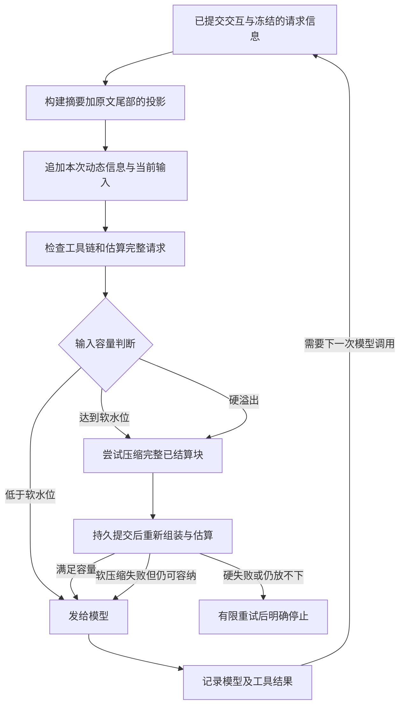

# Octo v1 设计与实现记录

更新日期：2026-11-12。

本文记录各部分的设计、实现位置、当前进度及验证结果。当前优先推进上下文 harness；每次按用户给出的步骤修改并展示结果，用户明确认可后才 commit。

## 1. 如何阅读与维护

- **现有实现**：本次已从源码确认的行为。
- **目标设计**：来自交接文档或会话决定、尚待落地的行为。
- **建议，待确认**：审阅中提出的具体接口、规则修订或实现选择。
- **验证记录**：只登记实际执行过的检查，注明适用范围；设计中的验收条件不等于测试已经通过。

设计发生变化时直接更新对应章节，并在末尾实现记录注明原因。实际实现与本文不一致时，先确认差异的原因，再同步设计和代码。

来源：用户提供的《Octo-v1-实现交接文档》、本会话后续修订，以及本机源码核查。交接文档中的旧规则由下文已确认的修订替代。

## 2. 总体目标与当前状态

Octo 是个人编程与系统运维助手。一个主 Agent 处理共享会话，话题帮助用户组织讨论，上下文 harness 控制每次模型输入，长期记忆保存可回溯的偏好与事实。

| 部分 | 当前实现 | v1 目标 |
| --- | --- | --- |
| 模型与工具主循环 | 已有流式调用、工具执行、事件通知；已增加可选调用前准备接口 | 后续接入完整上下文策略 |
| 会话存储 | JSONL 条目树与恢复 | 新会话以 SQLite 为唯一权威 |
| 话题与请求归因 | 尚无 v1 话题模型；旧条目树与话题图分别处理 | 共享历史、手动话题、发送时冻结请求归属 |
| 上下文 harness | 已完成可选准备接口、消息副本隔离与投影工具链校验 | 接入预算、压缩门控、持久快照与追踪 |
| 长内容与会话压缩 | bash 已有输出截断；会话已有摘要压缩 | 持久 artifact、完整批次切点、非破坏投影 |
| 长期记忆 | 尚无 v1 结构化事实库与提炼队列 | 阈值驱动异步提炼、证据引用、幂等恢复 |
| 子 Agent | 尚无本方案的只读委派接口 | 当前请求内委派，工具结果回传 |
| Plan 模式 | 尚无本方案的状态工具与执行拦截 | schema 固定、提醒与执行层控制 |
| Skill | 已有发现、索引注入和显式展开 | 按需正文、pin、真实加载记录 |
| 桌面与可视化 | 已有 CLI / Textual TUI | Electron + Next.js、FastAPI、话题图与 Skill 面板 |

表中分别标记现有实现与 v1 目标；目标不能作为已完成能力对外描述。

## 3. 会话、话题和请求

### 设计

- **共享会话历史**：同一会话所有话题已经发生的交互。话题切换不会丢弃其他话题历史。
- **话题**：用户手动建立的讨论归属，可有父子关系；它不是独立 Agent 或独立执行上下文。
- **请求**：一次用户发送及后续模型、工具交互。`request_id → topic_id` 在发送时冻结。
- **分叉锚点**：从哪条旧消息继续讨论；不是退回那一时刻的知识状态。
- **话题摘要**：用于导航和检索；与缩短模型输入的会话压缩摘要分别维护。

全局时间顺序、话题父子关系和请求归因分别存储。用户在 A 话题发送后切到 B，A 的流式内容、工具结果及最终回复仍属于 A。前台请求线性处理；子 Agent 返回结果并入当前请求，不增加独立完成播报。

### 实现与验收

目标位置：`octo_agent/topics.py` 及会话编排层，尚未建立。模型输入中的话题信息取当前请求冻结的归属，不读取生成过程中变化的 UI 焦点。

验收：发送到 A 后切到 B，结果归属保持 A；从旧消息建立子话题不改变旧消息归属；纯导航不触发模型请求。

## 4. 存储与权威来源

### 已确认设计

新会话以 **SQLite 为唯一权威**，JSONL 用于旧历史导入和导出。新架构不依赖两种格式同时写成功来维持正确性。

目标使用 `$OCTO_HOME/octo.db`，SQLite WAL。建议由一个 Python 后端拥有写入，TUI 与桌面共用后端逻辑；进程独占和连接方式在接入桌面时明确。

主要记录：会话、话题、请求、只增消息、artifact、压缩摘要与 head、记忆条目与任务/收据、子运行、Skill 加载、更正记录。

- 已提交消息正文保持不变。压缩只增加摘要、改变投影所用的 head。
- 会话内 `seq` 表示时间顺序；消息 ID 表示稳定引用，不能用列表下标或 Python 对象地址作为持久证据 ID。
- 请求、输入消息及归属应一致提交；摘要记录和 head 推进在同一事务提交。
- 旧 JSONL 导入须保留可追踪映射，重复导入去重。历史分支导入规则单独明确，不自动把旧 `parent_id` 当成新话题关系。

### 当前实现

`octo_agent/session/storage.py` 负责 JSONL 读写，`octo_agent/session/memory.py` 按 active leaf 路径重建上下文。SQLite ledger 尚未建立。迁移完成前，现有程序仍运行旧存储路径；不能把它描述为已使用 SQLite。

验收：提交中断后恢复一致；重复导入不重复生成消息；按证据 ID 可读取原文；压缩不更新或删除旧消息正文。

## 5. 上下文 harness（当前优先部分）

### 5.1 职责与接入位置

目标：在**每一次主 Agent 模型调用前**，从已发生交互组装本次输入，估算完整请求，必要时压缩，并给出可追踪的调用视图。它不负责执行工具，也不承担后台记忆模型调用。

当前调用链：

```text
CodingSession
  → AgentHarness
  → run_agent_loop
  → _provider_context
  → _assistant_events
  → ModelProvider.stream_response
```

源码依据：`octo_agent/loop.py`、`octo_agent/harness.py`、`octo_agent/provider.py`。

**已实现首个切片**：在 `run_agent_loop` 调用 `_assistant_events` 之前增加可等待的 `prepare_context` 接口，由 `AgentHarnessConfig` 注入，首轮及每个工具批次后的下一轮均经过它。准备逻辑集中在 `octo_agent/context_harness.py`。当前 `CodingSession` 尚未装配新策略，CLI 默认行为仍走旧路径。

现有 `replace_messages()` 会重新绑定列表，运行中循环仍持有原列表，因此不能仅在 `turn_end` 监听器里调用它来替换下一轮输入。事件通知适合记录与入队，不能作为隐含的上下文替换机制。

选择循环调用前接口的理由：它明确覆盖每个主调用，也能与摘要模型调用区分，避免在 provider 外层包装后，摘要调用递归进入压缩。

### 5.2 输入与输出接口草案

以下是表达设计的类型草图，尚未创建这些类或冻结字段：

```python
class RequestContext:
    session_id: str
    request_id: str
    topic_id: str

class HistorySnapshot:
    # 持久记录的稳定 ID、消息内容、读取位置与压缩 head
    ...

class PreparedContext:
    messages: tuple[AgentMessage, ...]
    estimated_input_tokens: int
    summary_ref: str | None
    notices: tuple[str, ...]

class ContextHarness:
    async def prepare(
        self, request: RequestContext, history: HistorySnapshot
    ) -> PreparedContext:
        ...
```

构造时注入稳定 system/tools、统一的有效模型限额、估算器、存储与压缩依赖。调用者只获取本次输入及诊断信息；预算、切点、摘要选择集中在模块内部。

首个切片实际接口为 `prepare_context(messages, *, signal)`，由 `PrepareContext` Protocol 声明参数：接收消息深副本组成的 tuple，异步返回消息序列。原始消息不被重绑定或改写；返回结果再次复制后校验工具链，然后只用于本次 provider 调用。system 与 tools 不在返回值中，不能通过该接口切换工具 schema。返回视图缺失调用/结果、顺序错误或调用与结果的工具名称不一致时抛出 `ValueError`，不会静默使用修复后的内容。

准备前后检查取消状态，取消以 `CancelledError` 上浮；正在等待中的准备函数需协作观察 signal，或由外层取消任务。当前不提供超时或强制中止忽略 signal 的任意回调。准备异常原样上浮，harness 清理运行状态。未配置准备函数时，保留原有历史修复和调用路径。

消息快照和投影分离：循环持续追加原始交互，`PreparedContext.messages` 仅供本次模型调用使用。投影使用独立的数据副本，不通过修改消息对象内容影响原始记录。SQLite 接入后，由会话层保证新消息已提交，再读取带版本位置的快照；测试可使用内存记录，不另建一套生产权威存储。

### 5.3 每次调用的处理流程



工具链检查必须针对最终发送视图；不能先预算，再无记录地增加修复消息。恢复时已有的工具历史修复与正常执行时的已结算判断分开：未完成调用不能靠补一个假结果变成可压缩块。

### 5.4 请求排列与前缀缓存

交接文档要求 system/tool schema 稳定。**建议修订，待确认**：本次动态块追加在已有历史之后，排列如下：

```text
稳定 system 与工具 schema
历史投影：压缩摘要（若有）+ 已提交的原文尾部
本次动态块：冻结的话题信息、画像快照、检索结果、需要注入的 Skill
当前用户输入及绑定在这次输入上的 reminder
```

本次动态块随调用记录保存，后续重放保持原位置与内容；异步更新的画像留到下一请求。新输入及动态块的具体 role/消息组合在实现时确定，记录必须能复现实际发出的顺序。

理由：动态信息若放在历史前面，每次变化都会让共同前缀在历史开始前分叉。只保证 system hash 相同，不能证明长段历史也能继续复用。

Plan 切换保持工具 schema 不变。用户主动变更模型、扩展、工具配置时形成新的明确配置版本，不承诺跨配置仍字节一致。压缩同样会改变历史投影，应记录缓存边界。

缓存验证区分：固定前置是否一致、共同前缀能保持多长，以及 provider 实际报告的缓存使用量。前两项不能替代真实缓存命中测量。

### 5.5 预算与软硬门控

现有位置：`octo_coding/context_window.py`、`octo_coding/session.py`、`octo_ai/model_limits.py`。当前阈值优先使用显式配置，再用 runtime limits，最后才回退到 `window - 16384`；runtime 默认存在 90% 阈值。新 Gate 接入时必须明确替代旧自动触发路径，避免两套机制同时工作。手动压缩可复用同一压缩实现。

交接文档目标软水位为 `floor(window * 0.74)`。原预留公式将输出预留封顶为 16384，可能小于实际发送的输出上限。

**建议修订，待确认**：统一解析模型限额和实际请求输出上限；对采用输入输出共享窗口的配置，使用：

```text
W = 有效上下文窗口
O = 实际发送的输出上限
M = 配置的估算安全余量
hard_input_limit = W - O - M
soft_limit = min(floor(W * 0.74), hard_input_limit)
```

限额未知或 `hard_input_limit <= 0` 时提供明确配置错误。不同 provider 的上下文/输出语义由模型适配层给出一致解释。`O` 不得与 provider 实际使用的 `max_tokens` 等参数独立计算。

估算包含 system、工具 schema、摘要、历史、动态块、当前输入和图片等内容。现有字符估算先复用适用部分；旧 usage 只有在输入投影仍一致时才能增量复用。文本估算不是精确 tokenizer，provider 明确返回超窗时仍须走硬压缩；不能把本地判断写成绝对不会超窗的保证。

软水位失败但仍满足硬容量时可继续，附 notice。硬溢出需实际缩减视图，整次 Gate 最多额外重试一次；网络/额度错误按其自身策略处理，取消与契约错误直接上浮。准备接口本身须能接受取消信号或等效取消机制。

### 5.6 追踪和验收

每次模型调用记录 request、调用序号、配置版本、来源快照位置、摘要引用、估算组成、有效限额及压缩结果。后台摘要调用与主调用分别标识。

验证通过同一个准备接口和实际 loop 的假 provider 进行：

1. 首次调用经过准备；一次工具往返后的第二次调用也经过准备。
2. 改变投影会改变假 provider 收到的消息，原始历史保持不变。
3. 启用新 Gate 后不会再触发第二套旧自动压缩。
4. 固定 system/schema 保持一致，动态块按位置重放，工具链保持完整。
5. 软水位、恰好满足硬容量、超过硬容量及输出限额不一致均有可观察结果。
6. 摘要调用不会递归触发主调用 Gate；取消能终止准备和摘要。

本部分当前状态：新增 5 项测试覆盖工具往返的两次调用、原文隔离、准备期间取消、非法工具链、工具名称错配以及准备异常传播后恢复。原有 11 项离线回归通过。预算、旧 Gate 替换、摘要调用区分、动态块持久重放及完整追踪仍待后续切片，不能据此声称整个上下文 harness 已完成。

## 6. 长内容外置与会话压缩

### 设计

第一层把长工具结果保存为持久 artifact，模型收到预览、ID 和回读方法。第二层对已结算的历史块生成摘要，保留近期原文与当前工作输入。artifact 保存成功后才能发布引用；失败时保持内容可得或明确失败。

回读工具需要分段读取或搜索定位，并返回游标/截断标记。整段回读又被外置会产生循环引用，验收必须覆盖从大日志中部找到指定内容。

摘要复用已有六段格式；保留话题归属、关键来源引用和未解决事项。只在工具调用与结果完整结算或已明确放弃的位置切分，约 20000 token 近期原文是目标而非固定保证。

摘要记录区分累计覆盖、实际送入摘要模型的原文、未读取的省略消息。摘要可使用上一代摘要更新，但长期记忆不从摘要正文再次提炼。摘要和 head 事务提交，并检查 parent 仍是当前 head；同一引用重放内容一致则幂等，内容漂移则拒绝。

### 实现与验收

已有六段提示和会话级自动压缩位于 `octo_coding/context_window.py` 与 `octo_coding/session.py`。新 artifact、摘要来源分区和 SQLite 原子 head 尚未实现；当前 bash 截断不等于持久 artifact 系统。

验收：回读能取得目标原文；未结算工具不能被压缩；摘要提交失败不推进 head；压缩后重新估算；反复压缩也不删除原始消息。

## 7. 长期记忆

### 已确认设计

分层保存常驻偏好、话题摘要、原始会话记录和语义事实。事实支持 `add / supersede / retract`，保留来源 ID、原文日期和状态。

触发规则已由用户确认修订：未学习交互累计达到阈值后异步入队；明确要求记住或更正时入队；正常结束会话时处理未学习尾部。使用摘要或成功压缩可作为额外触发。具体阈值尚未确定。

编排器只负责持久入队，提炼模型在主生成循环外运行；读取明确允许的原文，不读摘要正文，也不以省略消息冒充已读取证据。用户偏好和更正引用真实用户输入。

任务在模型调用前落盘；模型生成操作草稿后校验来源和字段。事实变更、学习游标和 applied 收据同事务提交。重复处理同一来源范围去重，无变化的成功提炼也推进游标。异常退出留下待恢复任务；正常关闭与强制终止的恢复语义分别测试。

### 待确认与实现

事实适用范围尚待用户确认。建议给事实注明项目、对象及必要环境/版本，例如测试环境 3.12 与生产环境 3.11 可以并存；不能把此建议写成已通过的字段设计。

目标位置：`octo_agent/memory/`，尚未建立。当前 SQLite schema、后台任务机制、模型选型、阈值均待实现或确定。

验收：短会话偏好能在下一会话召回；助手转述不能写成用户事实；来源校验、重复任务、崩溃恢复和日期保留正确。事实适用范围的验收随决定补充。

## 8. 只读子 Agent

目标设计：主 Agent 在当前请求内调用 `delegate_task`，子循环只读文件、搜索和整理证据，结果以工具结果返回。子运行不直接写事实库、不派下一层子 Agent。

返回状态、摘要、证据 ID 和是否未验证；超时或预算耗尽时返回已收集内容并停止。`unverified=true` 是状态说明，不能单靠这个字段保证主 Agent 已查验。关键证据回读流程和来源内容是否支持结论分别验证。

目标位置：`octo_agent/subagents.py`，尚未建立。验收覆盖实际写入被拒、超时取消、部分结果和证据可回读，不宣称任意模型都能发现所有语义错误。

## 9. Plan 模式

交接文档目标：固定工具 schema，使用 `EnterPlanMode / ExitPlanMode` 切换状态，绑定 reminder；写操作由执行层判断。当前未实现。

实现前明确哪些工具具备只读保证。任意 shell 命令不能仅凭名称或关键词当作可靠只读操作；Plan 下开放的能力需要有可验证的执行范围。模式控制保护用户工作区操作，不能阻止程序记录会话、入队或保存自己的正常内部状态。

目标位置：模式状态、`before_tool_call` 接入及工具定义。验收：模式切换不改变 schema，写操作没有副作用，正常读工具可用。

## 10. Skill 发现、加载与界面记录

现有实现：`octo_coding/skills.py` 发现并读取 `SKILL.md`；`system_prompt.py` 默认注入名称、描述和位置索引，提示模型读取全文；显式 `/skill:name` 可展开正文。不能把现状写成默认注入全部 Skill 正文。

目标设计：正文按需加载，用户可启用和 pin，记录每请求实际加载、来源、原因和估算成本。回读原文等是可调用工具能力，可在 Skill 库展示相应使用说明；Skill 文本本身不能替代工具实现。

目标位置：`octo_coding/skills_runtime.py`，尚未建立。`load_skill` 与模型直接读 Skill 文件的实际注入应能被统一追踪；跨请求 pin 需避免重复正文无限累积。

验收：库中存在不等于本轮加载；加载 trace 与实际输入一致；正文和索引成本明确标为估算。

## 11. 桌面、服务与话题图

交接文档选型：Electron + TypeScript / Next.js，Python FastAPI，本地 SQLite。当前仅有 CLI/TUI，这些新增目录与依赖尚未落地。

桌面左侧话题图，中间线性消息，右侧 Skill/证据详情。树从话题和请求关系生成，与线性视图读取同一份记录；折叠只改变显示。

目标位置：`octo_server/`、`desktop/`、`web/`。后端随机本地端口与启动 token，preload 暴露最小连接能力；Next.js 静态导出的路由和资源方式需在 Electron 中实际验证。

发送使用客户端幂等键；流式接口要定义事件序号、重连游标、快照与后续事件衔接、完成状态，才能实现刷新恢复。连接方式需支持选定的认证头；具体 SSE/WS 客户端尚待确定。

验收：双击启动能聊天，刷新不丢已发生输出或重复执行请求，切换话题不改变归属；正常退出与崩溃后的后端/请求恢复规则明确。

## 12. 实现顺序和验证方式

遵循 Matt 的完整行为切片：每一步完成一条能演示、能验证的路径。当前先做上下文 harness，以下是建议顺序，不视为用户已授权执行全部步骤。

| 切片 | 可验证的结果 | 前置条件 |
| --- | --- | --- |
| 调用前接口（已完成） | 一次请求两次模型调用都经过准备；投影变化不改原始记录 | 基于现有 loop/harness，已完成本轮验证 |
| 完整请求预算 | 假 provider 能观察软/硬门控和统一输出限额 | 调用前接口、模型参数统一 |
| 持久视图 | SQLite 保存原文与稳定 ID，重启能重建输入 | 最小 SQLite 会话记录与快照 |
| 外置与回读 | 大结果经 ID 定位读取中部内容 | artifact 持久化及读取工具 |
| 会话压缩 | 工具往返后触发 Gate、提交摘要并继续回答 | 准备接口、持久视图、摘要 head |
| 异步记忆 | 短会话偏好持久入队，在下一会话召回 | 原文 ID、任务及收据事务 |

优先复用 `tools/verify.py` 的离线假模型与临时存储；新增测试覆盖对外行为。现有验证中有“核心注释恰好 13 条”的历史断言，后续代码增长时应调整为有意义的维护约束，不能为了保持固定计数破坏测试意图。

实际指标区分归因正确性、证据召回、输入 token、真实缓存、成本与延迟。合成回放只报告其测试条件；本轮没有新增或运行性能测量。

## 13. 实现记录

| 日期 | 范围 | 已发生的改动 | 验证与提交状态 |
| --- | --- | --- | --- |
| 2026-11-12 | 设计记录 | 建立本文，整理各部分方案、状态及 harness 接入草案；纳入 SQLite 权威来源和阈值记忆触发的已确认修订 | 仅文档；源码未改；未 commit |
| 2026-11-12 | harness 调用前接口 | 新增 `octo_agent/context_harness.py`；在 `loop.py` 和 `harness.py` 接入可选异步准备；隔离消息副本、检查取消并拒绝错误工具链 | `python -B -m unittest discover -s tools -p test_context_harness.py -v`：5 项通过；`python -B tools/verify.py`：11 项通过；`git diff --check` 通过；用户已授权以独立分支 PR 交付 |

本切片按 Matt 的红绿循环实现：工具往返测试先因缺少配置入口失败，再实现接口转绿；取消测试先失败，再加调用前后检查；错误工具链与工具名称错配分别先复现再修复。异常传播与恢复作为补充行为检查。独立双轴审查中，Standards 提出回调参数契约应显式声明，已改为 Protocol；Spec 发现工具 ID 一致但名称不一致的投影可被放行，已修复并增加回归。Spec 独立复核无未解决发现；Standards 唯一建议已按要求修订，主线程核对接口与测试结果。

参考核查：本轮读取本机 `akashic-agent` 克隆，HEAD 与指定提交 `86428bb9b1d7e164f3e92adb15fdca0523709876` 一致；查看 `plugins/context/contract.py` 的准备/构造合同和 `plugins/context/plugin.py` 的构造入口。Octo 的 loop hook 是适配本项目调用链的接口，没有引入其插件运行时。本轮核查范围不等于已逐文件移植全部压缩与记忆模块。

后续每次实现补充：实际改动位置、完成的可观察行为、执行的检查及结果、未解决限制。用户明确允许提交后，再记录实际 commit；检查通过本身不代表允许提交。
